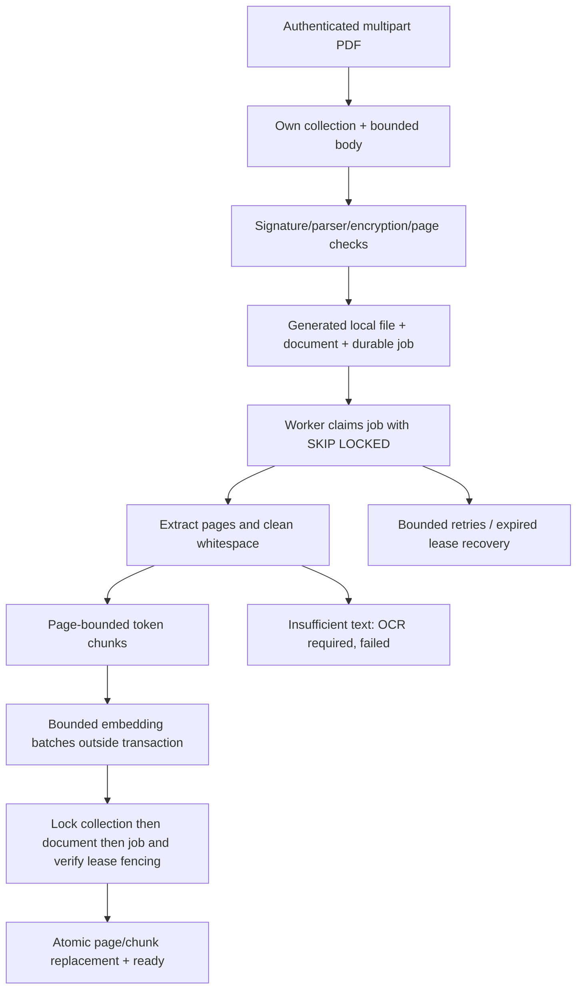
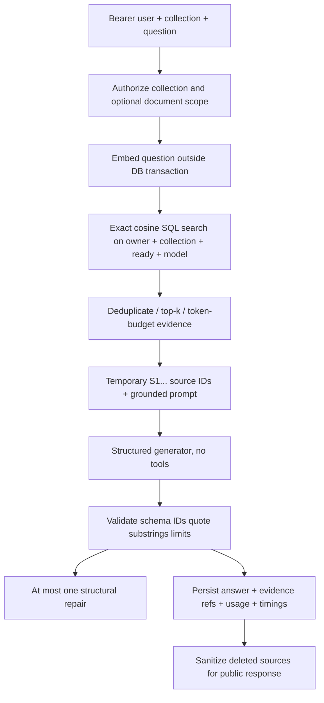

# Architecture and operational boundaries

SourceDesk is one codebase with two processes: FastAPI serves HTTP; a synchronous
worker claims persistent PostgreSQL jobs. SQLAlchemy handles relational data;
pgvector stores 1536-dimensional embeddings. Local generated storage keys hide
user filenames. `pypdf` extracts text; `tiktoken` bounds page-local chunks. Small
embedding and generation provider interfaces avoid an orchestration framework.

## Ingestion



Upload acceptance means queued, not searchable. Duplicate content in the same
collection returns HTTP 409 rather than duplicating chunks. Different collections
may hold the same PDF. A generated storage filename and bounded upload do not
make arbitrary PDFs safe; see security limitations.

Original downloads snapshot at most one accepted PDF into memory while holding
its document lock, then return the bytes after releasing the transaction. This
avoids a deferred-file-read race with DELETE, at the cost of up to the configured
upload limit in additional memory per concurrent download. It is not a streaming
download implementation.

Workers release database transactions before extraction and network calls.
Publication, renewal and failure lock collection, then document, then job so
collection deletion cannot deadlock against chunk foreign-key publication.
Claims increment attempts and carry a lease token. Expired leases can be
reclaimed; completion checks the token and document existence before replacing
chunks. Replacement and ready status commit together. Per-page/position unique
constraints are a second idempotency guard. A deleted document cannot be
resurrected by a stale result. Provider retries and job retries are separate
bounded budgets, so total calls may multiply.

One worker processes one document at a time. Lease renewal happens between
bounded operations, not continuously during a blocked HTTP request or parser
call. Configure the lease longer than the worst bounded batch call (including
retries) plus margin. Large or malicious extraction can still overrun a lease;
fencing prevents stale writes but does not sandbox the parser or avoid all
wasted external calls.

## File deletion outbox

Deleting a document or collection writes its original-file storage keys to
`file_cleanup_tasks` in the same transaction that removes the document records.
Those tasks intentionally have no document foreign key. The API attempts a small
post-commit batch; the worker drains due tasks before claiming ingestion work.
An unlink error does not turn a committed DELETE into HTTP 500. The task remains
durable with an attempt counter, safe error category and capped backoff; other
keys can still progress. A crash after unlink but before task commit is safe
because an already-missing file counts as successful cleanup. A short local-file
operation runs under a `SKIP LOCKED` task row lock; no model call does.

Database access and source visibility disappear immediately. Disk deletion can
be delayed by permissions, storage failure or a stopped worker. This outbox covers
committed document deletion, not files orphaned by an upload process dying
between file creation and document commit; those still need reconciliation.

## Question answering



Retrieval uses exact cosine **distance**, lower is nearer, not a calibrated
probability. SQL filters ownership on collection, document and chunk, document
readiness and embedding model before ranking. Optional document IDs only narrow
scope. A candidate pool up to four times configured top-k allows near-duplicate
removal; final evidence is bounded by top-k and context tokens. Recall in the
evaluator is measured on these **supplied passages**, not raw pre-dedup ranks.
No similarity threshold is advertised as calibrated. Exact scans are intentional
for this small corpus; approximate indexes require measured scale/recall needs.

The real provider receives a grounding instruction plus serialized question and
untrusted evidence, never tools. Source IDs are backend assigned; a model cannot
invent a page reference. `answered`, `insufficient_evidence`,
`provider_unavailable`, and `generation_error` remain distinct outcomes. A
syntactically valid citation still does not establish factual support.

## Modules

- `auth`, `api`, `main`: login, ownership CRUD, body limits, errors, probes.
- `storage`, `ingestion`, `chunking`: local originals, extraction, token chunks.
- `worker`: durable jobs and lease-fenced final writes.
- `providers`, `retrieval`, `generation`, `questions`: model IO, scoped SQL,
  validation and persisted question history.
- `evaluation`: real-HTTP harness, authorized local diagnostics and pure metrics.

HTTP logs contain correlation IDs, status and duration, not request bodies or
bearer tokens. Provider failures log safe categories/attempt counts. Persisted
answer timings describe request stages. Not every ingestion stage has a separate
persisted timing field; inspect actual worker logs rather than assuming one.

## Reindexing maintenance

Changing provider, embedding model or chunking requires rebuilding stored chunks.
A different vector dimension requires a separate schema migration as well;
`EMBEDDING_DIMENSIONS` other than 1536 is rejected in v1.

1. Back up database and originals. Stop API traffic and workers (Ctrl+C); do not
   serve a partially rebuilt corpus. Keep the originals in the same upload dir.
2. Change provider/model/chunk settings and set a **new**
   `SOURCEDESK_PROCESSING_VERSION` in `.env` (for example `v2`). Ensure API, worker
   and maintenance CLI load exactly the same settings.
3. Preview, then explicitly confirm all-document maintenance:

   ```bash
   uv run --locked python -m scripts.reindex
   uv run --locked python -m scripts.reindex --confirm-all
   ```

4. The transaction locks jobs/documents, invalidates leases, clears old pages and
   chunks, resets attempts/errors, sets the new processing version and queues
   each document. An old lease cannot publish after this reset. Historical
   answer text remains; old chunk references become unavailable/redacted.
5. Restart worker, wait for documents to become ready; inspect failed documents.
   Restart API traffic and run dev evaluation. No immediate quality improvement
   is promised by reindexing. The script never changes `.env` itself.

The CLI targets **all tenants** with the configured database role, not an HTTP
user. It is a trusted local administrator operation, not a public endpoint.
Keep maintenance credentials and its output out of untrusted hands. On a large
corpus a single transaction is not a scalable online migration strategy.
