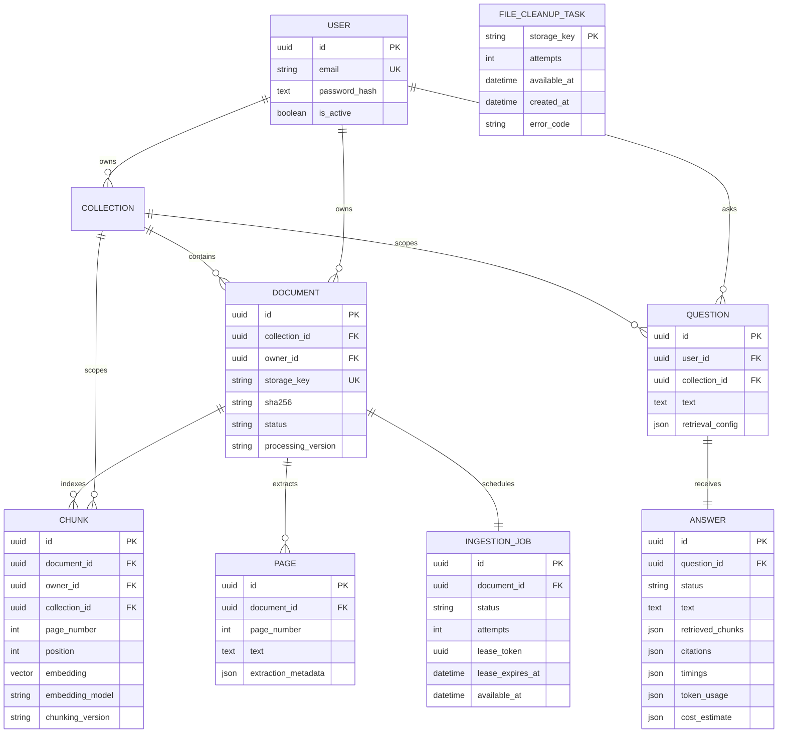

# Relational model and deletion

All primary keys are UUIDs. Timestamps are timezone-aware UTC. Schema creation
is an Alembic operation, not an implicit `create_all` on API startup.

## Constraints and useful indexes

- Normalized email is unique; password hash contains adaptive Argon2 output,
  never a reversible or plaintext password.
- `(collection_id, sha256)` prevents duplicate document content per collection.
- `(document_id, page_number)` uniquely identifies a one-based PDF page.
- `(document_id, page_number, position)` prevents duplicate chunk positions;
  positive token counts and page numbers are checked.
- One ingestion job per document; one answer per question. Cleanup task keys are
  unique and deliberately have no foreign key to a removed document.
- Chunk owner/collection, document owner/collection/status and job claim fields
  have lookup indexes. The embedding uses `Vector(1536)` without an approximate
  search index; exact cosine search is the baseline.
- Foreign keys cascade collection deletion into documents, pages, chunks, jobs,
  questions and answers. Ownership is checked in services/SQL, not PostgreSQL
  row-level security; direct database credentials bypass HTTP isolation.

Embedding model is recorded per chunk, prompt/model metadata per answer,
retrieval config per question. Source references are JSON snapshots rather than
foreign keys to chunks, allowing historical answer text to survive deleting its
source. Generated answer text may itself paraphrase or quote source content.

## Deletion is not a full historical erasure promise

**Document deletion:** removes pages, chunks and the job, and transactionally
queues the original file for idempotent deletion. Its
collection's questions and answers remain. GET answer and sources routes check
whether each referenced source still exists and is authorized; removed/reindexed
source excerpts and quotes are redacted and marked `available: false`.
IDs/page metadata may remain as tombstones. The historical answer text remains
unchanged and may contain the deleted fact: this is deliberate audit history,
not a legal erasure implementation. Stored JSON snapshots can retain evidence
internally; public response redaction is not a physical purge of all copies.

**Collection deletion:** removes the collection's documents and its question /
answer history, plus original files through the application deletion path.
Database cascades alone cannot remove local files. A durable cleanup outbox is
committed alongside application deletion, with API best-effort draining and
worker retries; a successful DELETE may precede physical unlink when storage is
unavailable. Backups, old reports,
external provider retention and disk recovery are outside these operations.
File cleanup and database commit are not a distributed atomic transaction, but
committed deletions retain a retryable storage key across crashes. Uploads that
die between file creation and document commit can still leave untracked files
and need separate reconciliation.

**Reindexing:** changes chunk IDs. Existing citations referring to replaced
chunks become unavailable and are sanitized, even though the PDF still exists.
New questions use the rebuilt index; old answers are not regenerated silently.
